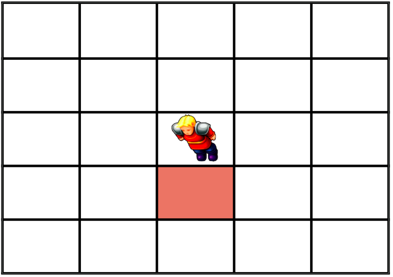
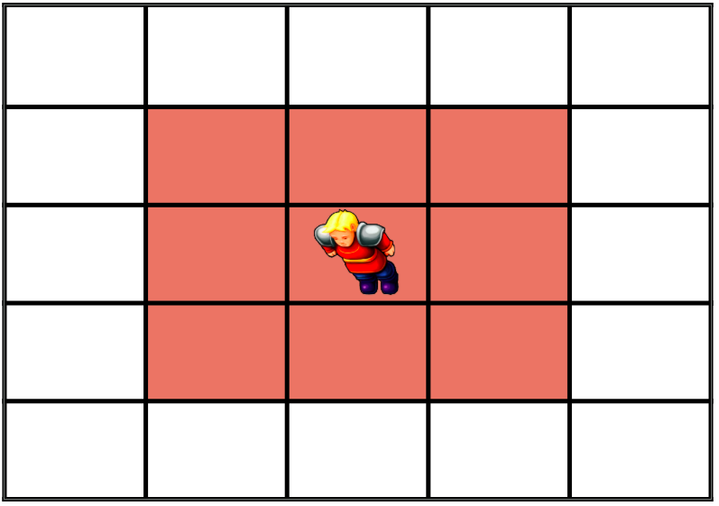
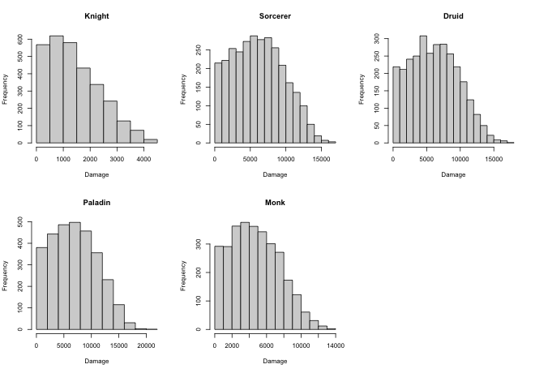
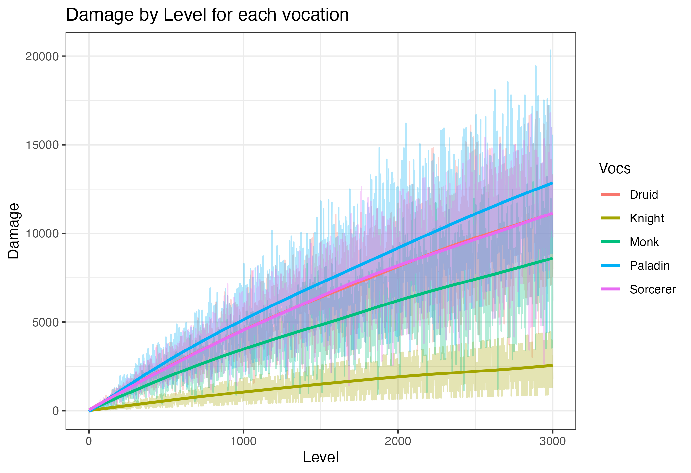
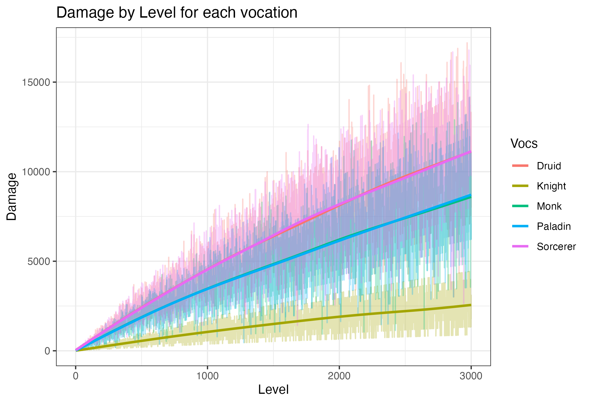

## Tibia Vocations Damage Modelling

For a long time I see players complaining about the (un)balancing of vocations and 
the enormous advantage that Paladins has, manly due to the use of Diamond Arrows after level 150. 
Basically, the main argument is that Paladins can hit in a certain area 2 times in a same turn. 
This ends in Paladins doing massive amount of damage compared to other vocations which can only hit in area only a single time in each turn. 
Well, I just got curious to see how this “grows” with the characters leveling and the real impact of Diamond Arrows when leveling. 
I construct a simple computer program which I like to share here and get some critics/recommendations about the modelling. 
The code will be available in Github so you can download and play with the model as I did.

### The Model

I am modelling how much damage does a single character of each of the five classes can do in a single turn. 
I am doing this as the characters levels grows. The damage modeled here is composed of 2 parts: Basic attacks and Area attacks. 

#### Basic Attacks

The Basic attack changes as the character get higher levels, as follows:
- From level 1 to level 500, each 5 levels adds 1 to the Base damage,
- From level 501 to level 1100, each 6 levels adds 1 to the Base damage,
- From level 1101 to level 1800, each 7 levels adds 1 to the Base damage… and so on (8 levels until 2600, 9 until 3500, 10 until 4300, 11 until 5200 and 12 until 6200).

The gains are cumulative: a character keeps all the Base damage gained in the previous brackets, so the Base damage never decreases.
For example, a level 500 character has 100 of Base damage, a level 1100 character has 200 and a level 3000 character has 444.
All the characters begins the same, with 1 of Base damage attack.

#### Area Attacks

The Area attack depends on how many monsters do you get in your area attack. 
Sometimes when you throw a GFB or a diamond arrow, you get 10 monsters, 
sometimes you get 1 monster or sometimes you are lucky and all the square meters (sqm’s) of your GFBs or arrow hit a monster. 
Nice. Area attacks depends on luck. For that, the Area damage is the Base Damage multiplied by the quantity of monsters that 
you hit when you trow a rune, send an diamond arrow, cast *exori gran*, etc, etc.
The quantity of how much monsters the characters hit in an single Area attack is sampled from a truncated normal distribution 
where the minimum value that hit is 1 and the maximum is the size, in sqm’s, that the Area attack hit.

In each turn, each vocation does:
- Knight: 1 Basic attack + *exori gran* (9 sqm)
- Sorcerer: 1 Basic attack + GFB (37 sqm) + *exori vis hur* (11 sqm)
- Druid: 1 Basic attack + Avalanche (37 sqm) + *exori terra hur* (11 sqm)
- Paladin: 1 Basic attack + Avalanche (37 sqm). From level 150, the Basic attack can be a Diamond Arrow (21 sqm)
- Monk: 1 Basic attack + Avalanche (37 sqm)

The damage of all the attacks in a turn is added. The Diamond Arrow is not an extra attack: it replaces the Paladin Basic attack, 
which then hits all the monsters in its area instead of a single one.

Let’s get a practical example. We have our knight named Knight, very creative. Knight can attack one base attack and one *exori gran* 
in a single turn. So in the level 1 turn, Knight could hit one Basic attack which the damage depends on the Knight’s level plus the Area attack 
which is an *exori gran* which has 9 sqm’s. The quantity of monsters that Knight will hit in the *exori gran* is a sampled number from 1 to 9 
sqm’s from a truncated normal distribution. Suppose that Knight is a lucky guy and in this level 1 turn, he hits 7 monsters with his *exori gran*. 
So the final damage of our Knight in the level 1 will be Base attack + Area attack => 1 + (1 * 7) = 8. 
That’s the basic intuition of our model. 

I let the model run for 3000 timesteps which represents the damage of our characters in the level 1 to level 3000.
In the script, `use_diamond_arrow` switches the Diamond Arrows on and off, and `save_figures` saves the figures below.

### Assumptions

Of course there a lot of simplifications of our model, but is a starting point so we can unravel how character damage changes over time 
in scenarios of different attacks and levels. Some simplifications are made:
- The Basic attacks always hits
- Regardless the level, all the characters can use all the runes and spells from their own vocation 
- Paladins can only use Diamond Arrows from level 150
- The damage of an Area attack is just the sum of Basic attacks in several sqm’s
- The characters do not waste any turn healing or doing other stuff, just attacking
- There are no items or spells that increase damage, only increase the sqm’s which the Basic attack hits

### Results with Diamond Arrows

On average, the damage in a turn (in multiples of the Base damage) is:

| Knight | Sorcerer | Druid | Paladin | Monk |
|---|---|---|---|---|
| 5.8 | 24.9 | 25.0 | 27.9 | 19.1 |

With Diamond Arrows, Paladins have the highest damage, but only about 12% above Sorcerers and Druids.
Nothing astronomic.

Paladins are on top along all the levels, close to Sorcerers and Druids. Knights are far behind.

Let's remove the Diamond Arrows from Paladins and see how the damage stays

### Results without Diamond Arrows

| Knight | Sorcerer | Druid | Paladin | Monk |
|---|---|---|---|---|
| 5.8 | 24.9 | 25.0 | 19.0 | 19.1 |

Without Diamond Arrows, Paladins have the same damage as Monks (both use a single Basic attack + Avalanche), 
and Druids and Sorcerers have the highest damage.

### (Basic) Conclusions

In this model, Diamond Arrows put Paladins on top, but by a small margin: they add about 9 times the Base damage per turn, 
which moves Paladins from the Monk level to slightly above Sorcerers and Druids. The "massive" damage advantage does not appear.
Also, since all the vocations share the same Base damage, the difference between vocations is the same at any level: 
leveling increases the damage of everyone, but does not change who is ahead.

The model is very simplistic and there is a lot of other factors affecting the damage that a player can do with a certain vocation
like ability of the player in never loose a attack turn or never miss an arrow turn, healing moments, KS, random factors in a hunt, 
spell cooldowns, magic level and skills, etc, etc. 
Nevertheless, it is a starting point to understand and answer the question about the vocations balance which is fundamental to understand because
influences XP/hr, money, TC's and the social relations within Tibia related to which vocation you choose to your guild or in a guild war context.

Finally, this does not completely answer our question but maybe we can start to talk about it in a more objective way.
